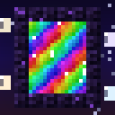

<div align="center">



# Endless Portals

**Throw a book into a Nether Portal. Walk into a world written by its words.**

A Fabric mod for Minecraft 26.3 that revives the *20w14∞* April Fools snapshot: chaotic procedural worlds, rainbow-animated portals, and an infinite bookshelf that never writes the same book twice.

[](https://github.com/elitexlite/Endless-portals/actions/workflows/build.yml)


[Install](#installation) · [Quick start](#quick-start) · [Features](#features) · [Named dimensions](#named-dimensions) · [Building](#building-from-source) · [Troubleshooting](#troubleshooting)

</div>

---

## Overview

In 2020, Mojang's April Fools snapshot **20w14∞** let players throw a written book into a Nether Portal and arrive in a dimension generated from the book's contents. Endless Portals brings that idea to modern Minecraft.

- **Deterministic.** The same words always lead to the same dimension, in any world or on any server.
- **Practically unlimited.** Every distinct book text maps to its own procedural dimension.
- **Properly weird worlds.** Most dimensions are chaotic: patchwork continents, floating shard fields, canyon-split plateaus, towers striped in random blocks, forests of mushrooms and crystals made of unrelated blocks.
- **Hand-made easter eggs.** 26 special titles open hand-built dimensions: a library, a Menger sponge, a llama world, a raid-farm-ready flatland and more.
- **Persistent.** Dimensions are saved with your world, so you always return to the same terrain.
- **Endless supply of books.** Craft a **Rainbow Infinite Bookshelf** and it hands out a brand-new signed book on every click, forever.

## Installation

| Requirement | Version |
| --- | --- |
| Minecraft: Java Edition | 26.3 |
| Java | 25 or newer |
| [Fabric Loader](https://fabricmc.net/use/) | 0.20.1 or newer |
| [Fabric API](https://modrinth.com/mod/fabric-api) | 0.166.2+26.3 or newer |

1. Install Fabric Loader for Minecraft 26.3.
2. Put **Fabric API** in your `mods` folder.
3. Download the latest **`EndlessPortals-*.zip`** from the [Releases page](https://github.com/elitexlite/Endless-portals/releases/latest). It contains the mod jar, this README and short install notes.
4. Extract the zip and copy the **`.jar`** (not the zip) into your `.minecraft/mods` folder.
5. Launch the game.

The mod is needed on **both client and server**. It adds blocks and custom world generators, so a vanilla client cannot join a server that runs it.

> **Tip.** Every push to `main` also produces a downloadable build: open the latest run under the repository's **Actions** tab and download the `EndlessPortals-zip` artifact.

## Quick start

1. **Get a book.** Craft a [Box of Infinite Books](#box-of-infinite-books) or a [Rainbow Infinite Bookshelf](#rainbow-infinite-bookshelf), or write and sign your own.
2. Build and light a standard **Nether Portal**.
3. **Throw the book** into the portal. The frame converts to an Endless Portal.
4. Step through. A return portal waits for you near the destination's spawn.

Prefer a specific place? Write a book titled `library`, sign it, and throw that in instead. See [Named dimensions](#named-dimensions).

## Features

### Rainbow Infinite Bookshelf

A glowing bookshelf whose spines ripple through the colors of the rainbow. **Right-click it** and you receive a freshly written, **signed** Written Book with random contents, printed in rainbow ink.

**Recipe** (shapeless): 1 Box of Infinite Books + the 7 rainbow dyes (red, orange, yellow, lime, light blue, blue, purple).

| Action | Result |
| --- | --- |
| Right-click | Gives a new signed book. Random title, author and 4 to 9 pages of prose. |
| Sneak + right-click | Passes through, so you can still place blocks against the shelf. |
| Break it | Drops the shelf. Axes are faster. |

**It can never give you the same book twice.** Every book takes the next number from a counter saved with your world, shared by *all* rainbow shelves in that world. That number is printed in the book's title and on its final page, and since the book text decides the destination dimension, **every book leads to its own dimension**. A random per-book value is mixed in too, so even a server crash that rolls the counter back cannot re-issue an old book.

### Box of Infinite Books

A craftable block that dispenses Written Books. Each box is tied to one book and therefore one dimension.

**Recipe**

```
B B B        B = Book
B S B        S = Bookshelf
B B B
```

| Action | Result |
| --- | --- |
| Right-click | Gives a Written Book with a generated title. The book is determined by the block's position, so the same block always gives the same book. |
| Right-click with an **Echo Shard** | **Binds** the box, locking its current seed permanently. A bound box glows. |
| Break a bound box | Drops as a glowing item that remembers its seed. Place it anywhere and it gives the same books. |
| Break an unbound box | Drops with no data. It generates books from wherever it is placed next. |

The box can be broken by hand, and an axe is faster.

### Endless Portal

A converted Nether Portal that leads to a custom dimension.

- **Rainbow animation.** The portal swirls through a flowing, translucent rainbow with sparkles. Each destination has its own hue offset, so different portals still look different.
- **Breaks as one.** Breaking any block of an Endless Portal removes the **whole portal** at once. Breaking a frame block next to one collapses it too, just like a vanilla portal.
- **Creating one.** Build and light a standard Nether Portal, then throw a Written Book into it. The book is consumed and the frame converts.
- **Redirecting.** Throw a different Written Book into an existing Endless Portal to point it somewhere new.
- **Return portals.** The first time you travel through a portal, a return portal is generated near the destination's spawn point.

Normal Nether Portals are unaffected. Only a thrown Written Book triggers conversion. Like vanilla portals, Endless Portals can only be broken in Creative.

## How books choose a dimension

When a Written Book enters a portal, the mod picks a destination using the first rule that matches:

1. **Generated book.** A book with exactly 16 pages, each holding two lowercase hex characters, spells out a 32-character dimension ID. This is the format the Box of Infinite Books produces. The pages decide the destination, not the title.
2. **Named dimension.** If the book's title, trimmed and lowercased, exactly matches a [named dimension](#named-dimensions), that dimension is used.
3. **Content hash.** Otherwise, all page text is joined, lowercased and hashed with MD5. The hash becomes the dimension ID. **The title is ignored.**

In practice:

- Two books with different titles but identical pages go to the same dimension.
- Changing a single letter on a page sends you somewhere completely different.
- A book with a blank title is rejected.
- Capitalization does not matter, so `Library`, `LIBRARY` and `library` are the same.

> **Example.** A book whose pages say `the hollow mountain` always opens the same procedural dimension, whatever it is titled and whoever throws it.

## Named dimensions

Write the title with a Book and Quill, sign the book, and throw it into a portal. Pages can say anything.

| Title | What you get |
| --- | --- |
| `ancient` | Deepslate, tuff and moss flat world |
| `ant` | White concrete floor (ant simulation placeholder) |
| `cave` | Dense stone with 3D-carved hollow voids |
| `checkers` | Black and white checkerboard floor, 4×4 squares |
| `chess` | Black and white checkerboard floor, 4×4 squares |
| `clubs` | Black and white checkerboard floor, 4×4 squares |
| `colors` | Four-quadrant floor: blue, red, green, yellow |
| `dark` | Stone below, obsidian surface |
| `farm` | A single bedrock floor with a normal day/night cycle. Built for farms, and pillager outposts spawn for raid farms. Mobs can spawn on bedrock in darkness, so light up your build area. |
| `flat` | Standard grass flat world |
| `floating` | Circular grass islands at y=80, repeating every 32 blocks |
| `gallery` | Infinite 8×8 bookshelf rooms linked by small passages |
| `grid` | Stone pillars on a 4-block grid over open void |
| `holes` | Flat world with circular holes punched through the floor every 48 blocks |
| `inverted` | Stone ceiling overhead, open void below |
| `library` | Infinite 8×8 bookshelf rooms linked by small passages |
| `llama` | Stone below, lime carpet surface |
| `message` | Nearly empty: one bedrock block at the origin |
| `museum` | Infinite 8×8 bookshelf rooms linked by small passages |
| `patterns` | Black and white concrete floor in a bitcount pattern |
| `skygrid` | Sparse grid of single blocks floating in the void |
| `slime` | Solid slime blocks from bedrock up to y=64 |
| `sponge` | Menger sponge fractal in sponge blocks, repeating every 27 blocks |
| `underground` | Dense stone with 3D-carved hollow voids |
| `void` | Single bedrock block at the origin, otherwise empty |
| `wall` | Stone pillars on a 4-block grid over open void |

Named dimensions are always available and never need to be discovered first.

## Procedural worlds

Any book that is not a named dimension leads to a procedural dimension, and the book's text fully decides what it looks like. Roughly **two out of three** dimensions are **chaotic**; the rest use one of 18 calmer classic styles.

### Chaotic styles

These are built from fractal and domain-warped noise, Voronoi regions and true 3D density, and every dimension also rolls its own scale, sea level and lava level, so no two look alike.

| Style | What it is |
| --- | --- |
| Patchwork | Voronoi regions that each pick a different landform (plains, hills, mesa, lake, spires, lava pit, bottomless chasm, terraces), blended at the borders, often in mismatched colors |
| Warped | Domain-warped mountains with real 3D overhangs and arches |
| Swiss | Ground riddled with spaghetti tunnels, huge caverns, lava seas and bottomless shafts |
| Shattered | Lens-shaped islands drifting at many altitudes over the void |
| Strata | Terraced mesas and canyons, striped in bands of random blocks |
| Spires | Needle peaks rising out of a sea, pierced by natural arches |
| Mixed sea | Continents and archipelagos where each ocean is water, lava or ice-capped |
| Cracked | A tiled plateau split by deep, V-shaped, lava-bottomed canyons |

**Random-block palettes.** Each chaotic dimension shuffles a pool of unrelated blocks with its seed and takes 8 for its strata and veins and 4 for its flora. One world might be terracotta, amethyst and moss; the next, basalt, honeycomb and blue ice.

**Funky flora.** Patchwork, Mixed sea and Cracked grow poles, blob trees, mushrooms, glowing crystals and boulders out of those random blocks.

**Safe arrival.** Every chaotic dimension carves a flat landing pad at the destination spawn, so the return portal never ends up buried or hanging over a void.

### Classic styles

The remaining dimensions pick one of 18 simpler styles:

| Style | Description |
| --- | --- |
| Flat | Bedrock, stone and a grass surface at y=64 |
| Hills | Gently rolling terrain, y=48 to 80 |
| Mountains | Tall noise-based peaks, y=40 to 140 |
| Ocean | Water-filled basin with the sea floor at y=30 |
| Floating | Disconnected stone islands at y=80 |
| Void | Bedrock floor only, otherwise empty |
| Cave | Mostly solid stone with ellipsoid-carved hollow pockets |
| Desert | Flat sandstone and sand plains |
| Mushroom | Flat mycelium surface |
| Inverted | Stone ceiling slab, open void below |
| Pillars | Tall narrow spires of varied height, separated by void |
| Archipelago | Ocean basin with scattered islands above sea level |
| Canyon | Flat plateau cut by deep, noise-carved chasms |
| Cavern | Dense solid mass with large 3D hollowed voids |
| Mesa | High plateau at y=100 with banded strata and canyon carving |
| Lava Sea | Variable terrain with lava fill at y≤31 |
| Frozen | Ocean-floor terrain filled with packed ice |
| Amplified | Mountains at triple amplitude |

Classic dimensions also get a seed-derived block palette, with a primary block replacing stone, a surface block and a subsurface block. Bedrock and water are never substituted.

> **Upgrading from an older build?** The chaotic styles change what new, unexplored chunks look like for dimensions that already exist. Chunks you have already visited are saved and stay as they were.

## Technical notes

- **Ids.** The mod id is `endless_portals` and the portal block is `endless_portals:endless_portal`. Older builds used `infinity_dimensions` / `infinity_portal`, so **portals and dimensions created by an old build are not recognised in an old world**. Run `tools/apply_update.py --keep-ids` instead if you need to keep loading those worlds.
- **Persistence.** Procedural dimensions are saved in world data and re-registered on every server start. The bookshelf counter is stored the same way.
- **Runtime creation.** Dimensions are created while the server runs. Creation requests are queued and processed at the end of the server tick, to avoid modifying the level map while the server iterates over it.
- **Weather.** Endless dimensions use the overworld's day/night cycle but do not advance the weather themselves. They follow the overworld's weather, which avoids rain flickering when many are loaded.
- **Return portals.** Placed near x=8, z=8 in the destination. Void and floating dimensions get a small stone platform automatically.
- **Custom worldgen.** The mod registers its own `ChunkGenerator` and `BiomeSource` types, plus the `farm_outposts` structure set. The chaotic terrain lives in `ChaosTerrain`, a pure function of seed and coordinates with no Minecraft dependencies, so neighbouring chunks always line up and it is safe on any worldgen thread.
- **Mixins.** Three: `NetherPortalMixin` (book detection), `WeatherCycleMixin` and `MinecraftServerAccessor` (runtime dimension access).

### Project layout

```
src/main/java/com/jrock/infinity/
├── block/       Box of Infinite Books, Rainbow Bookshelf, Endless Portal, break handler
├── dimension/   Dimension manager, book hashing, named dimensions, saved data
├── item/        Item registration
├── mixin/       Portal, weather and server-access mixins
└── worldgen/    Chunk generators, ChaosTerrain, biome source, block palettes
src/main/resources/
├── assets/endless_portals/   Icon, models, blockstates, animated textures, lang
└── data/endless_portals/     Dimensions, dimension types, recipes, loot tables, structure set
tools/
├── gen_textures.py   Regenerates every animated rainbow texture
├── gen_icon.py       Regenerates the mod icon
├── package.sh        Builds the release zip (jar + README + install notes)
└── apply_update.py   One-shot migration script
.github/workflows/    CI: build, boot-a-server smoke test, release on tag
```

## Building from source

Requirements: **JDK 25**. Gradle is provided by the wrapper.

```
git clone https://github.com/elitexlite/Endless-portals.git
cd Endless-portals
./gradlew build          # Windows: gradlew.bat build
bash tools/package.sh    # optional: builds dist/EndlessPortals-<version>.zip
```

The built jar is written to `build/libs/`. Use the file without the `-sources` suffix. To test in a dev client, run `./gradlew runClient`, or `./gradlew runServer` for a dev server.

Versions live in `gradle.properties` (`minecraft_version`, `loader_version`, `fabric_api_version`, `loom_version`). Check [fabricmc.net/develop](https://fabricmc.net/develop) for the current set. When porting to a new Minecraft version, update those first, **and update the `minecraft` range in `fabric.mod.json`**. A mismatch there makes Fabric refuse to load the mod.

### Continuous integration and releases

The **Build** workflow runs on every push and pull request:

1. **Build & package.** Compiles the mod and uploads `EndlessPortals-<version>.zip`, containing the jar, this README and install notes, plus the bare jar.
2. **Smoke test.** Boots a real dev server and fails if the game never reaches *Done* or logs a fatal error, and uploads the server log either way. Startup crashes show up here before anyone downloads a build.
3. **Release.** Pushing a tag such as `v1.2.0` publishes a GitHub Release with both files attached, once the build and smoke test pass.

```
git tag v1.2.0
git push origin v1.2.0
```

## Troubleshooting

**The game says "Incompatible mod set" or that the mod requires a different Minecraft version.**
Use Minecraft 26.3, Fabric Loader 0.20.1+ and Fabric API 0.166.2+26.3 or newer. If you are building your own jar, make sure the `minecraft` range in `fabric.mod.json` matches your target version.

**The game won't start on an older Java.**
Minecraft 26.x requires Java 25. Check which Java your launcher is using.

**Nothing happens when I throw a book in.**
The book must be a *Written Book*, so a Book and Quill has to be signed first. It must have a title, and it must be thrown into a lit Nether Portal.

**My book goes somewhere different than my friend's.**
Only the *page text* decides the destination, apart from the exact named titles. Check for stray spaces, punctuation and line breaks.

**I can't break a portal in survival.**
Like vanilla portals, Endless Portals are unbreakable in survival. Break the frame in Creative, or use `/setblock ~ ~ ~ air`.

**The `farm` dimension has mobs on the floor.**
Mobs spawn on bedrock in the dark. Light up your build area.

**I'm stuck in a void dimension.**
Use the return portal at the destination spawn, which is on an automatic stone platform near x=8, z=8.

Found a bug? Open an [issue](https://github.com/elitexlite/Endless-portals/issues) with your Minecraft, Fabric Loader and Fabric API versions and the `latest.log` from `.minecraft/logs/`. If the game crashed, include the newest file from `.minecraft/crash-reports/` as well.

## Credits

- Concept and original implementation: Mojang Studios, in the *20w14∞* April Fools snapshot. This mod is an unofficial fan port and is not affiliated with Mojang or Microsoft.
- Based on [Eclipseth3sun/infinity-dimensions](https://github.com/Eclipseth3sun/infinity-dimensions), the original Fabric port. This repository continues it as **Endless Portals**.
- Port and mod: **jrock**.
- Built with [Fabric](https://fabricmc.net/).

## License

Released under the **MIT License**.
